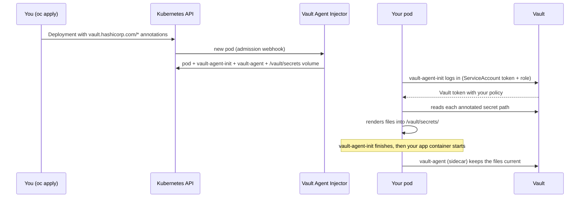

# Getting Vault Secrets into Your Pod — Usage Guide for Application Teams

| | |
|---|---|
| **Audience** | Developers and application owners who deploy to `pes-nonprod`, `pes-dev` or `hcs-devassets` |
| **Starting point** | Your secrets are already stored in Vault, and your Vault **policy and role already exist** (Backstage "Onboard an application to Vault" or the platform team did that) |
| **What this guide covers** | Only the **pod side**: which annotations to add to your Deployment, and how the secret values show up inside your containers (§1–§16). Or, without the injector, how your application reads secrets on demand through the Vault API with its ServiceAccount (§17) |
| **What it does not cover** | Installing Vault, auth mounts, policies, roles, or the injector. See [vault-agent-injector-guide.md](vault-agent-injector-guide.md) |

> **Status.** The annotations and templates come from the HashiCorp Vault Agent Injector documentation and the setup
> in [vault-agent-injector-guide.md](vault-agent-injector-guide.md). **None of the examples have been run** on your
> clusters. Try each one on a test deployment first, and check the agent log if something differs from what is shown here.
> The API examples in §17 follow the Vault HTTP API and the client libraries' documentation, and are untested too.
>
> **Demo values.** `admin`, `secretP@ss123`, `newadmin` and similar values are examples only. Never put real passwords in
> manifests, tickets, chat or Git.

---

## Table of contents

1. [Before you start: what you need](#1-before-you-start-what-you-need)
2. [How injection works](#2-how-injection-works)
3. [The five rules](#3-the-five-rules)
4. [Template cheat sheet](#4-template-cheat-sheet)
5. [Scenario 1 — One secret path, several keys](#5-scenario-1--one-secret-path-several-keys)
6. [Scenario 2 — Several secret paths, several keys each](#6-scenario-2--several-secret-paths-several-keys-each)
7. [Scenario 3 — Secrets as environment variables](#7-scenario-3--secrets-as-environment-variables)
8. [Scenario 4 — Secrets inside a config file](#8-scenario-4--secrets-inside-a-config-file)
9. [Scenario 5 — Certificates, keys and multi-line values](#9-scenario-5--certificates-keys-and-multi-line-values)
10. [Scenario 6 — Unusual key names and optional keys](#10-scenario-6--unusual-key-names-and-optional-keys)
11. [Scenario 7 — Every secret under a prefix](#11-scenario-7--every-secret-under-a-prefix)
12. [Scenario 8 — Several containers and init containers](#12-scenario-8--several-containers-and-init-containers)
13. [Scenario 9 — Jobs and CronJobs](#13-scenario-9--jobs-and-cronjobs)
14. [Scenario 10 — Changing secrets while the pod runs](#14-scenario-10--changing-secrets-while-the-pod-runs)
15. [Scenario 11 — File names, locations and permissions](#15-scenario-11--file-names-locations-and-permissions)
16. [Scenario 12 — Structured (object / JSON) values](#16-scenario-12--structured-object--json-values)
17. [Scenario 13 — Reading secrets on demand through the Vault API](#17-scenario-13--reading-secrets-on-demand-through-the-vault-api)
18. [Per-cluster differences](#18-per-cluster-differences)
19. [Where the annotations go (workload types)](#19-where-the-annotations-go-workload-types)
20. [Verify it works](#20-verify-it-works)
21. [Troubleshooting](#21-troubleshooting)
22. [Do and don't](#22-do-and-dont)
23. [Annotation reference](#23-annotation-reference)

---

## 1. Before you start: what you need

Collect these seven values. Everything below is built from them.

| # | Value | Example in this guide | Where you get it |
|---|---|---|---|
| 1 | Cluster | `pes-dev` | Where your pod runs |
| 2 | Namespace | `myns` | Where your pod runs |
| 3 | Application name | `myapp` | The name used at onboarding |
| 4 | ServiceAccount | `myapp-sa` | Onboarding result (default `<app>-sa`). Your pod **must** run as this one |
| 5 | Auth path | `auth/k8s-pes-dev` | `auth/k8s-<cluster>` |
| 6 | Role | `pes-dev-myns-myapp` | `<cluster>-<namespace>-<app>`, from the onboarding result |
| 7 | Secret path(s), **API form** | `secret/data/hce/nordcloud/pes-dev/myns/myapp` | The path your policy allows (see below) |

**The API path has `data/` in it.** Your secret is stored with a CLI path like
`secret/hce/nordcloud/pes-dev/myns/myapp`. In every annotation and template, write it as
`secret/data/hce/nordcloud/pes-dev/myns/myapp`. Leaving out `data/` is the most common cause of `permission denied`.

| You were told (CLI / UI path) | You write in the pod annotation |
|---|---|
| `secret/hce/nordcloud/pes-dev/myns/myapp` | `secret/data/hce/nordcloud/pes-dev/myns/myapp` |
| `secret/hce/nordcloud/pes-dev/myns/newapp` | `secret/data/hce/nordcloud/pes-dev/myns/newapp` |

> **Your path prefix may differ from these examples.** This guide uses the layout from the examples
> (`secret/hce/nordcloud/<cluster>/<namespace>/<app>`). The onboarding automation in the main guide grants
> `secret/<cluster>/<namespace>/<app>`. Always use the path **your** policy grants. If you read a path the policy does not
> cover, Vault answers `permission denied`, and no annotation can change that.

**You also need to know the key names** stored at each path (for example `user`, `password`, `dbname`). They are
case-sensitive. Ask whoever stored the secret, or, if you have Vault access, run
`vault kv get -mount=secret hce/nordcloud/pes-dev/myns/myapp`.

The example data used below:

| Secret path (CLI form) | Keys and (demo) values |
|---|---|
| `secret/hce/nordcloud/pes-dev/myns/myapp` | `user=admin`, `password=secretP@ss123`, `dbname=tenantdb`, `host=db.myns.svc`, `port=5432` |
| `secret/hce/nordcloud/pes-dev/myns/newapp` | `user=newadmin`, `password=newSecretP@ss999`, `dbname=catalogdb`, `host=catalog-db.myns.svc`, `port=5432` |

---

## 2. How injection works



What this means for you:

- **You change only annotations** (and `serviceAccountName`). No Vault code, no Vault client in your image.
- **Secrets arrive as files** in the shared in-memory volume `/vault/secrets/`. They are there **before** your app
  starts, because the init container renders them first.
- **One annotation pair per file.** `agent-inject-secret-<name>` says *which Vault path*. `agent-inject-template-<name>`
  says *what the file looks like*. `<name>` becomes the file name.
- **The pod gets 2 containers** (your app + `vault-agent`) plus the init container. `READY 2/2` is normal.

---

## 3. The five rules

1. **Annotations go on the pod template** (`spec.template.metadata.annotations`), not on the Deployment's own
   `metadata`. Annotations on the Deployment itself are ignored.
2. **Annotation values are strings.** Write `"true"`, never bare `true` (YAML turns it into a boolean and `oc apply` rejects it).
3. **The pod must run as the ServiceAccount from your role** (`serviceAccountName: myapp-sa`). Any other
   ServiceAccount, including `default`, is refused at login.
4. **One pod uses one role.** All the paths in that pod must be allowed by the policy attached to that one role (see §6.1).
5. **Use the API path with `data/`** and the **exact, case-sensitive key names**.

The injector is the default, but it is not the only way in. If your application should fetch secrets itself, when it
needs them, it can log in through the Vault API with the same ServiceAccount and role (§17). Rules 3–5 apply there too.

---

## 4. Template cheat sheet

Templates use the Go / Consul Template syntax. For a KV v2 secret, the values are under `.Data.data`.

| You want | Template |
|---|---|
| One value | `{{ .Data.data.password }}` |
| Read a secret, then use several keys | `{{ with secret "secret/data/<path>" }} … {{ end }}` |
| Trim blank lines around a block | `{{- with … -}}` … `{{- end -}}` (the `-` removes whitespace on that side) |
| Every key/value | `{{ range $k, $v := .Data.data }}{{ $k }}={{ $v }}{{ "\n" }}{{ end }}` |
| Key with a hyphen or dot | `{{ index .Data.data "db-user" }}` |
| Optional key with a default | `{{ or (index .Data.data "port") "5432" }}` |
| Whole secret as JSON | `{{ .Data.data \| toJSON }}` (also `toJSONPretty`) |
| Whole secret as YAML | `{{ .Data.data \| toYAML }}` |
| Upper-case a name | `{{ $k \| toUpper }}` |
| Decode a base64 value | `{{ .Data.data.keystore \| base64Decode }}` |
| Read a second secret in the same file | a second `{{ with secret "…" }}` block |
| Static text around values | just write it: `jdbc:postgresql://{{ .Data.data.host }}:5432/…` |

Key facts:

- A key that does not exist renders as `<no value>`. Fix the key name; do not ignore it.
- Keys in `range` come out in alphabetical order.
- Whatever is written outside `{{ … }}` is copied literally into the file.

---

## 5. Scenario 1 — One secret path, several keys

**Goal.** `secret/hce/nordcloud/pes-dev/myns/myapp` holds `user`, `password`, `dbname`, `host`, `port`. Your app reads
them from `/vault/secrets/db`.

### 5.1 Complete example (cluster `pes-dev`, namespace `myns`)

```yaml
apiVersion: apps/v1
kind: Deployment
metadata:
  name: myapp
  namespace: myns
  labels:
    app: myapp
spec:
  replicas: 1
  selector:
    matchLabels:
      app: myapp
  template:
    metadata:
      labels:
        app: myapp
      annotations:
        # --- who you are -------------------------------------------------
        vault.hashicorp.com/agent-inject: "true"
        vault.hashicorp.com/auth-path: "auth/k8s-pes-dev"
        vault.hashicorp.com/role: "pes-dev-myns-myapp"

        # --- agent resources (needed if the namespace has a ResourceQuota) -
        vault.hashicorp.com/agent-requests-cpu: "50m"
        vault.hashicorp.com/agent-limits-cpu: "250m"
        vault.hashicorp.com/agent-requests-mem: "64Mi"
        vault.hashicorp.com/agent-limits-mem: "128Mi"

        # --- what to inject: file /vault/secrets/db ------------------------
        vault.hashicorp.com/agent-inject-secret-db: "secret/data/hce/nordcloud/pes-dev/myns/myapp"
        vault.hashicorp.com/agent-inject-template-db: |
          {{- with secret "secret/data/hce/nordcloud/pes-dev/myns/myapp" -}}
          user={{ .Data.data.user }}
          password={{ .Data.data.password }}
          dbname={{ .Data.data.dbname }}
          host={{ .Data.data.host }}
          port={{ .Data.data.port }}
          {{- end -}}
    spec:
      serviceAccountName: myapp-sa          # must match the role's bound ServiceAccount
      containers:
        - name: app
          image: registry.access.redhat.com/ubi9/ubi-minimal:latest
          command: ["/bin/sh", "-c", "sleep infinity"]     # replace with your real start command
          resources:
            requests: { cpu: 50m, memory: 32Mi }
            limits:   { cpu: 200m, memory: 128Mi }
          securityContext:
            allowPrivilegeEscalation: false
            capabilities:
              drop: ["ALL"]
```

Inside the app container, `/vault/secrets/db` contains:

```
user=admin
password=secretP@ss123
dbname=tenantdb
host=db.myns.svc
port=5432
```

Your app then reads that file (or you load it as environment variables, §7).

### 5.2 Choose the file format

Only the `agent-inject-template-<name>` annotation changes. Keep the other annotations the same.

**A. No template at all** (the quickest, but not usually what you want). With only `agent-inject-secret-db`, the agent
writes Go's raw map print, including KV metadata:

```
data: map[dbname:tenantdb host:db.myns.svc password:secretP@ss123 port:5432 user:admin]
metadata: map[created_time:2026-… deletion_time: destroyed:false version:1]
```

Your app cannot parse that easily. Write a template instead.

**B. `key=value` lines** (works for `.env`, Java `.properties`, shell `source`): the template in §5.1.

**C. Only some keys.** Name only what the app needs, and leave the rest out of the pod:

```yaml
vault.hashicorp.com/agent-inject-template-db: |
  {{- with secret "secret/data/hce/nordcloud/pes-dev/myns/myapp" -}}
  user={{ .Data.data.user }}
  password={{ .Data.data.password }}
  {{- end -}}
```

**D. All keys, without naming them** (new keys appear automatically):

```yaml
vault.hashicorp.com/agent-inject-template-db: |
  {{- with secret "secret/data/hce/nordcloud/pes-dev/myns/myapp" -}}
  {{- range $k, $v := .Data.data }}
  {{ $k }}={{ $v }}
  {{- end }}
  {{- end -}}
```

**E. JSON file** (for apps that read `config.json`):

```yaml
vault.hashicorp.com/agent-inject-template-db: |
  {{- with secret "secret/data/hce/nordcloud/pes-dev/myns/myapp" -}}
  {{ .Data.data | toJSON }}
  {{- end -}}
```

Result: `{"dbname":"tenantdb","host":"db.myns.svc","password":"secretP@ss123","port":"5432","user":"admin"}`

**F. YAML file:**

```yaml
vault.hashicorp.com/agent-inject-template-db: |
  {{- with secret "secret/data/hce/nordcloud/pes-dev/myns/myapp" -}}
  {{ .Data.data | toYAML }}
  {{- end -}}
```

**G. One key per file** (apps that read `/secrets/password` style files). Use one annotation pair per key, each with a
template that prints just that value, with no trailing newline:

```yaml
vault.hashicorp.com/agent-inject-secret-db-user: "secret/data/hce/nordcloud/pes-dev/myns/myapp"
vault.hashicorp.com/agent-inject-template-db-user: |
  {{- with secret "secret/data/hce/nordcloud/pes-dev/myns/myapp" -}}{{ .Data.data.user }}{{- end -}}
vault.hashicorp.com/agent-inject-secret-db-password: "secret/data/hce/nordcloud/pes-dev/myns/myapp"
vault.hashicorp.com/agent-inject-template-db-password: |
  {{- with secret "secret/data/hce/nordcloud/pes-dev/myns/myapp" -}}{{ .Data.data.password }}{{- end -}}
```

This gives `/vault/secrets/db-user` and `/vault/secrets/db-password`.

**H. A derived value, such as a connection URL:**

```yaml
vault.hashicorp.com/agent-inject-template-db-url: |
  {{- with secret "secret/data/hce/nordcloud/pes-dev/myns/myapp" -}}
  postgresql://{{ .Data.data.user }}:{{ .Data.data.password }}@{{ .Data.data.host }}:{{ .Data.data.port }}/{{ .Data.data.dbname }}
  {{- end -}}
```

> **Special characters.** A password like `secretP@ss123` is fine in a `key=value` file. If a value can contain
> characters that your file format treats specially (a URL needs `@`, `:` and `/` escaped; JSON and YAML are handled by
> `toJSON`/`toYAML`), prefer the JSON or YAML output, or percent-encode inside the template.

---

## 6. Scenario 2 — Several secret paths, several keys each

**Goal.** One pod needs both:

- `secret/hce/nordcloud/pes-dev/myns/myapp` → `user=admin`, `password=secretP@ss123`, `dbname=tenantdb`, …
- `secret/hce/nordcloud/pes-dev/myns/newapp` → `user=newadmin`, `password=newSecretP@ss999`, `dbname=catalogdb`, …

Both paths have the **same key names** (`user`, `password`, `dbname`), so they must not be merged blindly: one would
overwrite the other, or the names would be ambiguous. Use **one file per path** or **prefixed names**.

### 6.1 First: the role's policy must allow both paths

A pod authenticates with **one role**, and that role has **one set of policies**. For both reads to succeed, the policy
must include both paths:

```hcl
path "secret/data/hce/nordcloud/pes-dev/myns/myapp"  { capabilities = ["read"] }
path "secret/data/hce/nordcloud/pes-dev/myns/newapp" { capabilities = ["read"] }
```

The standard per-application policy created at onboarding covers only the application's own path and the paths
**below** it (`…/myapp` and `…/myapp/*`). `…/newapp` is a **sibling**, not a child, so it is **not** covered. Without it
the agent fails with `permission denied` on the second path, and the pod stays in `Init`.

Choose one:

| Option | What to do | When |
|---|---|---|
| **A. Store it below your own path** (simplest) | Keep the second secret at `secret/hce/nordcloud/pes-dev/myns/myapp/newapp` and use that in the annotation | The second secret is really part of your application |
| **B. Ask for the policy to be extended** | Ask the platform team to add the second path to your role's policy (send them the HCL above) | A separate path that must stay where it is |
| **C. Split the workload** | Put the part that needs `newapp` in its own pod/Deployment with its own role | `newapp` is another application. Its owner should approve access |

> **Option B and the onboarding pipeline.** The Backstage pipeline refuses to overwrite a policy whose paths differ
> from what it generates. After the platform team extends a policy by hand, re-running the onboarding for that
> application fails by design. That is expected; changes to that application's access go through the platform team.

If the second path belongs to **a different application**, make sure its owner agrees. You are gaining read access to
their credentials.

### 6.2 Recommended: one file per path

```yaml
      annotations:
        vault.hashicorp.com/agent-inject: "true"
        vault.hashicorp.com/auth-path: "auth/k8s-pes-dev"
        vault.hashicorp.com/role: "pes-dev-myns-myapp"
        vault.hashicorp.com/agent-requests-cpu: "50m"
        vault.hashicorp.com/agent-limits-cpu: "250m"
        vault.hashicorp.com/agent-requests-mem: "64Mi"
        vault.hashicorp.com/agent-limits-mem: "128Mi"

        # File 1: /vault/secrets/myapp-db  <- .../myns/myapp
        vault.hashicorp.com/agent-inject-secret-myapp-db: "secret/data/hce/nordcloud/pes-dev/myns/myapp"
        vault.hashicorp.com/agent-inject-template-myapp-db: |
          {{- with secret "secret/data/hce/nordcloud/pes-dev/myns/myapp" -}}
          user={{ .Data.data.user }}
          password={{ .Data.data.password }}
          dbname={{ .Data.data.dbname }}
          host={{ .Data.data.host }}
          port={{ .Data.data.port }}
          {{- end -}}

        # File 2: /vault/secrets/newapp-db  <- .../myns/newapp
        vault.hashicorp.com/agent-inject-secret-newapp-db: "secret/data/hce/nordcloud/pes-dev/myns/newapp"
        vault.hashicorp.com/agent-inject-template-newapp-db: |
          {{- with secret "secret/data/hce/nordcloud/pes-dev/myns/newapp" -}}
          user={{ .Data.data.user }}
          password={{ .Data.data.password }}
          dbname={{ .Data.data.dbname }}
          host={{ .Data.data.host }}
          port={{ .Data.data.port }}
          {{- end -}}
```

The `<name>` suffix in `agent-inject-secret-<name>` and `agent-inject-template-<name>` must be **identical**. A
template whose name matches no `agent-inject-secret-*` annotation is silently unused.

The pod then has:

```
/vault/secrets/myapp-db      user=admin / password=secretP@ss123 / dbname=tenantdb / …
/vault/secrets/newapp-db     user=newadmin / password=newSecretP@ss999 / dbname=catalogdb / …
```

The rest of the Deployment (`serviceAccountName: myapp-sa`, the app container) is the same as in §5.1.

### 6.3 Both secrets in one file, with prefixed keys

When the app wants a single file, give each key a prefix so nothing collides:

```yaml
        vault.hashicorp.com/agent-inject-secret-all: "secret/data/hce/nordcloud/pes-dev/myns/myapp"
        vault.hashicorp.com/agent-inject-template-all: |
          {{- with secret "secret/data/hce/nordcloud/pes-dev/myns/myapp" -}}
          MYAPP_USER={{ .Data.data.user }}
          MYAPP_PASSWORD={{ .Data.data.password }}
          MYAPP_DBNAME={{ .Data.data.dbname }}
          {{- end }}
          {{ with secret "secret/data/hce/nordcloud/pes-dev/myns/newapp" -}}
          NEWAPP_USER={{ .Data.data.user }}
          NEWAPP_PASSWORD={{ .Data.data.password }}
          NEWAPP_DBNAME={{ .Data.data.dbname }}
          {{- end -}}
```

`/vault/secrets/all` then contains:

```
MYAPP_USER=admin
MYAPP_PASSWORD=secretP@ss123
MYAPP_DBNAME=tenantdb
NEWAPP_USER=newadmin
NEWAPP_PASSWORD=newSecretP@ss999
NEWAPP_DBNAME=catalogdb
```

Only one `agent-inject-secret-all` annotation is needed. The path in it is just what the injector uses to know that a
secret is wanted; the template reads whatever it names. Still, make that first path one of the real paths.

### 6.4 Many paths, a compact way

For three or more paths, loop over a comma-separated list of path suffixes:

```yaml
        vault.hashicorp.com/agent-inject-secret-all: "secret/data/hce/nordcloud/pes-dev/myns/myapp"
        vault.hashicorp.com/agent-inject-template-all: |
          {{- range $app := split "," "myapp,newapp" -}}
          {{- with secret (printf "secret/data/hce/nordcloud/pes-dev/myns/%s" $app) -}}
          {{- range $k, $v := .Data.data }}
          {{ $app | toUpper }}_{{ $k | toUpper }}={{ $v }}
          {{- end }}
          {{- end -}}
          {{- end -}}
```

> This loop is not tested. `split` and `printf` should be available in the agent's template engine, but if your agent
> version reports a template error, use the explicit form in §6.3. Every path in the list must also be allowed by the
> role's policy (§6.1).

---

## 7. Scenario 3 — Secrets as environment variables

Vault Agent writes **files**. It cannot add environment variables to a running process. To get env vars, render a file
of `export` lines and **source it in the container's start command**.

### 7.1 One path

```yaml
      annotations:
        vault.hashicorp.com/agent-inject: "true"
        vault.hashicorp.com/auth-path: "auth/k8s-pes-dev"
        vault.hashicorp.com/role: "pes-dev-myns-myapp"
        vault.hashicorp.com/agent-inject-secret-env: "secret/data/hce/nordcloud/pes-dev/myns/myapp"
        vault.hashicorp.com/agent-inject-template-env: |
          {{- with secret "secret/data/hce/nordcloud/pes-dev/myns/myapp" -}}
          export DB_USER='{{ .Data.data.user }}'
          export DB_PASSWORD='{{ .Data.data.password }}'
          export DB_NAME='{{ .Data.data.dbname }}'
          {{- end -}}
    spec:
      serviceAccountName: myapp-sa
      containers:
        - name: app
          image: <your image>
          command: ["/bin/sh", "-c"]
          args:
            - |
              . /vault/secrets/env
              exec <your real start command>        # e.g. exec java -jar /app/app.jar
```

### 7.2 Several paths (names prefixed)

```yaml
        vault.hashicorp.com/agent-inject-secret-env: "secret/data/hce/nordcloud/pes-dev/myns/myapp"
        vault.hashicorp.com/agent-inject-template-env: |
          {{- with secret "secret/data/hce/nordcloud/pes-dev/myns/myapp" -}}
          export MYAPP_USER='{{ .Data.data.user }}'
          export MYAPP_PASSWORD='{{ .Data.data.password }}'
          export MYAPP_DBNAME='{{ .Data.data.dbname }}'
          {{- end }}
          {{ with secret "secret/data/hce/nordcloud/pes-dev/myns/newapp" -}}
          export NEWAPP_USER='{{ .Data.data.user }}'
          export NEWAPP_PASSWORD='{{ .Data.data.password }}'
          export NEWAPP_DBNAME='{{ .Data.data.dbname }}'
          {{- end -}}
```

### 7.3 Things that matter

- **`exec` the real process.** Without `exec`, the shell stays as PID 1 and does not forward signals, so pod shutdown
  is slow or unclean.
- **`command` replaces the image's `ENTRYPOINT`, and `args` replaces its `CMD`.** Find the original start command first
  (`oc image info <image>` or the image's Dockerfile) and repeat it after `exec`.
- **Single quotes protect most characters** (`$`, spaces, `"`). They break only if a value itself contains `'`. Test
  with your real values.
- **Key names become variable names.** Keep keys to `[A-Za-z_][A-Za-z0-9_]*`. A key like `db-user` cannot be a
  variable name. Rename it in Vault, or map it explicitly: `export DB_USER='{{ index .Data.data "db-user" }}'`.
- **Env vars do not change while the process runs.** The file is refreshed (§14), but the already-started process keeps
  its old values until it restarts.
- **Use the app's own file support if it has one.** Many frameworks can read a properties or JSON file. That avoids
  wrapping the start command and lets the app pick up changes.

---

## 8. Scenario 4 — Secrets inside a config file

The app expects a full configuration file with a few secret values inside. Put the whole file in the template. The
static text is copied as it is.

```yaml
        vault.hashicorp.com/agent-inject-secret-application: "secret/data/hce/nordcloud/pes-dev/myns/myapp"
        vault.hashicorp.com/agent-inject-template-application: |
          {{- with secret "secret/data/hce/nordcloud/pes-dev/myns/myapp" -}}
          server.port=8080
          logging.level.root=INFO

          spring.datasource.url=jdbc:postgresql://{{ .Data.data.host }}:{{ .Data.data.port }}/{{ .Data.data.dbname }}
          spring.datasource.username={{ .Data.data.user }}
          spring.datasource.password={{ .Data.data.password }}
          {{- end -}}
```

Point the app at the file, and name it as the app expects it:

```yaml
        vault.hashicorp.com/agent-inject-file-application: "application.properties"
        vault.hashicorp.com/secret-volume-path-application: "/app/config"
```

The file is then `/app/config/application.properties`. (`agent-inject-file-<name>` sets the file name,
`secret-volume-path-<name>` sets the directory; see §15.)

**Keep non-secret settings out of Vault.** Put the static parts in a ConfigMap, and keep Vault only for the secret
values, unless the app needs a single combined file.

---

## 9. Scenario 5 — Certificates, keys and multi-line values

Store PEM files as multi-line values (for example `tls_crt`, `tls_key`). Render each into its own file:

```yaml
        vault.hashicorp.com/agent-inject-secret-tls-crt: "secret/data/hce/nordcloud/pes-dev/myns/myapp"
        vault.hashicorp.com/agent-inject-template-tls-crt: |
          {{- with secret "secret/data/hce/nordcloud/pes-dev/myns/myapp" -}}{{ .Data.data.tls_crt }}{{- end -}}
        vault.hashicorp.com/agent-inject-file-tls-crt: "tls.crt"

        vault.hashicorp.com/agent-inject-secret-tls-key: "secret/data/hce/nordcloud/pes-dev/myns/myapp"
        vault.hashicorp.com/agent-inject-template-tls-key: |
          {{- with secret "secret/data/hce/nordcloud/pes-dev/myns/myapp" -}}{{ .Data.data.tls_key }}{{- end -}}
        vault.hashicorp.com/agent-inject-file-tls-key: "tls.key"

        vault.hashicorp.com/secret-volume-path: "/etc/tls"
```

Result: `/etc/tls/tls.crt` and `/etc/tls/tls.key`.

- **Binary content** (a Java keystore, a `.p12`) must be stored base64-encoded, then decoded in the template with
  `{{ .Data.data.keystore | base64Decode }}`. Check that the decoded file is intact (`file`, `keytool -list`) before
  you rely on it.
- **Store certificates from files**, so newlines survive: `vault kv put -mount=secret <path> tls_crt=@cert.pem tls_key=@key.pem`.
- **Permissions.** See §15 before changing them on OpenShift.

---

## 10. Scenario 6 — Unusual key names and optional keys

| Situation | Template |
|---|---|
| Key `db-user` (hyphen), or `db.user` (dot) | `{{ index .Data.data "db-user" }}` |
| Key may be missing, with a default | `{{ or (index .Data.data "port") "5432" }}` |
| Prefix every key | `{{ range $k, $v := .Data.data }}APP_{{ $k \| toUpper }}={{ $v }}{{ "\n" }}{{ end }}` |

`<no value>` in a rendered file means the key name in the template does not exist in Vault, or differs in case
(`Password` is not `password`).

---

## 11. Scenario 7 — Every secret under a prefix

Your application keeps several secrets under `secret/hce/nordcloud/pes-dev/myns/myapp/…` (for example `…/myapp/db`,
`…/myapp/api`), and you want each of them rendered without listing them in the manifest.

**Requires an extra permission.** Listing needs `list` on the **metadata** path, which the standard policy does not
include. Ask the platform team to add:

```hcl
path "secret/metadata/hce/nordcloud/pes-dev/myns/myapp"   { capabilities = ["list"] }
path "secret/metadata/hce/nordcloud/pes-dev/myns/myapp/*" { capabilities = ["list"] }
```

Then one template renders them all:

```yaml
        vault.hashicorp.com/agent-inject-secret-all: "secret/data/hce/nordcloud/pes-dev/myns/myapp"
        vault.hashicorp.com/agent-inject-template-all: |
          {{- range secrets "secret/metadata/hce/nordcloud/pes-dev/myns/myapp" -}}
          {{- $name := . -}}
          {{- with secret (printf "secret/data/hce/nordcloud/pes-dev/myns/myapp/%s" $name) -}}
          {{- range $k, $v := .Data.data }}
          {{ $name | toUpper }}_{{ $k | toUpper }}={{ $v }}
          {{- end }}
          {{- end -}}
          {{- end -}}
```

If you do not need new secrets to appear automatically, list the paths explicitly (§6). It is simpler and needs no
extra permission.

---

## 12. Scenario 8 — Several containers and init containers

### 12.1 Which containers see the secrets

By default `/vault/secrets` is mounted into **all** the application containers of the pod. To restrict it:

```yaml
vault.hashicorp.com/agent-inject-containers: "app"            # comma-separated container names
```

### 12.2 An init container that needs a secret

Your own init containers (a DB migration, for example) run **before or after** `vault-agent-init`, depending on a
setting. To make sure the secrets are already rendered when they run:

```yaml
vault.hashicorp.com/agent-init-first: "true"
```

Example init container that reads a rendered file:

```yaml
      initContainers:
        - name: migrate
          image: <migration image>
          command: ["/bin/sh", "-c", ". /vault/secrets/env && exec ./migrate up"]
```

Check the order with `oc get pod … -o jsonpath='{.spec.initContainers[*].name}'`: `vault-agent-init` must be listed
before `migrate`. If your init container still cannot see `/vault/secrets`, check its log, and ask the platform team
whether your injector version mounts the volume into init containers.

### 12.3 One path per container

Give each path its own `<name>`, and use `agent-inject-containers` to keep the secrets from reaching containers that do
not need them. Note that a single pod still uses a single role (§6.1).

---

## 13. Scenario 9 — Jobs and CronJobs

The `vault-agent` sidecar never exits, so a Job pod would never reach `Completed`. Use the init container only:

```yaml
vault.hashicorp.com/agent-pre-populate-only: "true"
```

The secrets are rendered once, before your container starts, and no sidecar runs afterwards.

For a **CronJob**, the annotations belong on the Job's pod template:

```yaml
apiVersion: batch/v1
kind: CronJob
metadata:
  name: nightly-report
  namespace: myns
spec:
  schedule: "0 2 * * *"
  jobTemplate:
    spec:
      template:
        metadata:
          annotations:
            vault.hashicorp.com/agent-inject: "true"
            vault.hashicorp.com/agent-pre-populate-only: "true"
            vault.hashicorp.com/auth-path: "auth/k8s-pes-dev"
            vault.hashicorp.com/role: "pes-dev-myns-myapp"
            vault.hashicorp.com/agent-inject-secret-db: "secret/data/hce/nordcloud/pes-dev/myns/myapp"
            vault.hashicorp.com/agent-inject-template-db: |
              {{- with secret "secret/data/hce/nordcloud/pes-dev/myns/myapp" -}}
              export DB_USER='{{ .Data.data.user }}'
              export DB_PASSWORD='{{ .Data.data.password }}'
              {{- end -}}
        spec:
          serviceAccountName: myapp-sa
          restartPolicy: OnFailure
          containers:
            - name: report
              image: <your image>
              command: ["/bin/sh", "-c", ". /vault/secrets/db && exec ./run-report"]
```

---

## 14. Scenario 10 — Changing secrets while the pod runs

| Event | What happens | What you do |
|---|---|---|
| The **value** changes in Vault (new KV version) | The `vault-agent` sidecar re-renders the file on its refresh interval (about 5 minutes by default for KV secrets). No pod restart | Nothing, but your app must **re-read the file** |
| The app reads the file only at startup | The app keeps the old value | Restart the pods: `oc rollout restart deploy/myapp -n myns` |
| The app uses environment variables (§7) | The environment cannot change in a running process | Restart the pods |
| You **change annotations** (new path, new key) | The pod template changed, so Kubernetes rolls out new pods | Apply the manifest and wait for the rollout |
| The policy or role changed | Takes effect at the next login or token renewal | Restart the pods if you need it immediately |

Tune the refresh interval:

```yaml
vault.hashicorp.com/template-static-secret-render-interval: "1m"
```

Run a command whenever a file is re-rendered (for example, to reload the app):

```yaml
vault.hashicorp.com/agent-inject-command-db: "/bin/sh -c 'kill -HUP $(pidof myapp) || true'"
```

- The command runs in the **`vault-agent` container**, not in your app container. To signal your app's process it must
  be visible there, which needs `spec.shareProcessNamespace: true` on the pod. Check that this is allowed in your
  namespace.
- A simpler choice for many teams: let the app watch the file, or use a restart controller (for example Stakater
  Reloader) to roll the Deployment when the secret changes.

Check which version of the secret is in the pod by comparing a value, or have the platform team look at Vault's audit
log. A pod shows only the current version.

---

## 15. Scenario 11 — File names, locations and permissions

| Need | Annotation | Example |
|---|---|---|
| Different directory for **all** files | `vault.hashicorp.com/secret-volume-path` | `"/app/config"` |
| Different directory for **one** file | `vault.hashicorp.com/secret-volume-path-<name>` | `…-db: "/etc/db"` |
| Different **file name** for one secret | `vault.hashicorp.com/agent-inject-file-<name>` | `…-db: "db.properties"` |
| File mode (octal) | `vault.hashicorp.com/agent-inject-perms-<name>` | `"0440"` |

Combined, for `/etc/db/db.properties`:

```yaml
vault.hashicorp.com/agent-inject-secret-db: "secret/data/hce/nordcloud/pes-dev/myns/myapp"
vault.hashicorp.com/secret-volume-path-db: "/etc/db"
vault.hashicorp.com/agent-inject-file-db: "db.properties"
```

**Do not mount your own volume at `/vault/secrets`**, and avoid a custom directory that already contains files you need
(the agent's volume covers the whole directory).

**OpenShift and file permissions.** OpenShift starts your container with a random user ID from the namespace's range.
The default file mode (`0644`) is readable by that user. A restrictive mode such as `0400` makes the file readable only
by the agent's user, and **your app then gets "permission denied" reading it**. Keep the default unless you also set an
explicit `runAsUser` on your container and use `vault.hashicorp.com/agent-run-as-same-user: "true"`. The volume is
in-memory (a `tmpfs`), so the files never touch the node's disk.

---

## 16. Scenario 12 — Structured (object / JSON) values

### 16.1 What an object value looks like

KV v2 stores each secret version as one JSON object. A value in it does not have to be a string. It can be a nested
object, an array, a number or a boolean. Example secret at `secret/hce/nordcloud/pes-dev/myns/myapp/config` (below
`myapp`, so the standard policy already covers it):

```json
{
  "database": {
    "host": "db.myns.svc",
    "port": 5432,
    "name": "tenantdb",
    "credentials": { "user": "admin", "password": "secretP@ss123" }
  },
  "replicas": [
    { "host": "db-r1.myns.svc", "port": 5432 },
    { "host": "db-r2.myns.svc", "port": 5432 }
  ],
  "features": { "cache": true, "maxConnections": 20 },
  "allowedOrigins": ["https://a.example.com", "https://b.example.com"],
  "service-account.json": "{\"type\":\"service_account\",\"project_id\":\"demo\"}"
}
```

The first four keys are real objects and arrays. The last one is different: it is a **string that contains JSON**.
Templates handle the two cases differently (§16.6).

### 16.2 How the secret must be written (tell whoever stores it)

| How it was written | What Vault stores |
|---|---|
| `vault kv put -mount=secret hce/nordcloud/pes-dev/myns/myapp/config - < config.json` (the file holds the whole object above) | Real nested objects and arrays |
| Vault UI, **JSON** toggle on, object pasted | Real nested objects and arrays |
| `vault kv put -mount=secret <path> database=@db.json` | Key `database` holds a **string** with the file's JSON text |
| `vault kv put -mount=secret <path> port=5432` | The **string** `"5432"`. `key=value` always stores strings |

Check what you have without printing any values. The output lists only the types:

```bash
vault kv get -format=json -mount=secret hce/nordcloud/pes-dev/myns/myapp/config | jq '.data.data | map_values(type)'
# { "database": "object", "replicas": "array", "features": "object", "allowedOrigins": "array", "service-account.json": "string" }
```

### 16.3 Nested fields

Use a dotted path for nested keys. `with` moves into an object, so the lines inside it stay short:

```yaml
        vault.hashicorp.com/agent-inject-secret-db: "secret/data/hce/nordcloud/pes-dev/myns/myapp/config"
        vault.hashicorp.com/agent-inject-template-db: |
          {{- with secret "secret/data/hce/nordcloud/pes-dev/myns/myapp/config" -}}
          {{- with .Data.data.database -}}
          host={{ .host }}
          port={{ .port }}
          dbname={{ .name }}
          user={{ .credentials.user }}
          password={{ .credentials.password }}
          {{- end }}
          cache_enabled={{ .Data.data.features.cache }}
          max_connections={{ .Data.data.features.maxConnections }}
          {{- end -}}
```

Result in `/vault/secrets/db`:

```
host=db.myns.svc
port=5432
dbname=tenantdb
user=admin
password=secretP@ss123
cache_enabled=true
max_connections=20
```

Inside `{{ with .Data.data.database }}`, the dot (`.`) is the `database` object. After its `{{ end }}`, the dot is the
whole secret again.

| Need | Template |
|---|---|
| Nested field | `{{ .Data.data.database.credentials.user }}` |
| Nested key with a hyphen or dot | `{{ index .Data.data "db-config" "user" }}` (one argument per level) |
| Only if the object exists | `{{ with .Data.data.database }}{{ .host }}{{ end }}` |
| Condition on a boolean | `{{ if .Data.data.features.cache }}cache=on{{ else }}cache=off{{ end }}` |

> **A missing object breaks the whole file.** If `database` does not exist, `{{ .Data.data.database.host }}` is a
> template **error**, and the agent stops rendering. That is different from a missing top-level key, which only prints
> `<no value>`. Wrap optional objects in `{{ with … }}`.

### 16.4 Arrays

```yaml
        vault.hashicorp.com/agent-inject-template-replicas: |
          {{- with secret "secret/data/hce/nordcloud/pes-dev/myns/myapp/config" -}}
          {{- range $i, $r := .Data.data.replicas }}
          replica_{{ $i }}={{ $r.host }}:{{ $r.port }}
          {{- end }}
          first_replica={{ index .Data.data.replicas 0 "host" }}
          allowed_origins={{ range $i, $o := .Data.data.allowedOrigins }}{{ if $i }},{{ end }}{{ $o }}{{ end }}
          {{- end -}}
```

Result:

```
replica_0=db-r1.myns.svc:5432
replica_1=db-r2.myns.svc:5432
first_replica=db-r1.myns.svc
allowed_origins=https://a.example.com,https://b.example.com
```

The `{{ if $i }},{{ end }}` part writes a comma before every element except the first, so the list is joined with no
trailing comma.

### 16.5 A whole sub-object as its own file

Many apps want a JSON or YAML file that looks exactly like one part of the secret:

```yaml
        vault.hashicorp.com/agent-inject-secret-database: "secret/data/hce/nordcloud/pes-dev/myns/myapp/config"
        vault.hashicorp.com/agent-inject-template-database: |
          {{- with secret "secret/data/hce/nordcloud/pes-dev/myns/myapp/config" -}}
          {{ .Data.data.database | toJSONPretty }}
          {{- end -}}
        vault.hashicorp.com/agent-inject-file-database: "database.json"
```

`/vault/secrets/database.json`:

```json
{
  "credentials": {
    "password": "secretP@ss123",
    "user": "admin"
  },
  "host": "db.myns.svc",
  "name": "tenantdb",
  "port": 5432
}
```

Use `toYAML` instead of `toJSONPretty` for a YAML file, and `toJSON` for a single line. Keys come out sorted
alphabetically. That is fine for any JSON or YAML parser.

### 16.6 JSON stored as a string

`service-account.json` holds JSON **text**. To write it out unchanged (for example as a cloud credentials file), print
the string:

```yaml
        vault.hashicorp.com/agent-inject-secret-sa-key: "secret/data/hce/nordcloud/pes-dev/myns/myapp/config"
        vault.hashicorp.com/agent-inject-template-sa-key: |
          {{- with secret "secret/data/hce/nordcloud/pes-dev/myns/myapp/config" -}}
          {{ index .Data.data "service-account.json" }}
          {{- end -}}
        vault.hashicorp.com/agent-inject-file-sa-key: "service-account.json"
```

To read single fields from it, parse it first with `parseJSON`:

```yaml
        vault.hashicorp.com/agent-inject-template-gcp: |
          {{- with secret "secret/data/hce/nordcloud/pes-dev/myns/myapp/config" -}}
          {{- with (index .Data.data "service-account.json" | parseJSON) -}}
          project_id={{ .project_id }}
          {{- end -}}
          {{- end -}}
```

If you use `toJSON` on a string value, you get the text again, but quoted and escaped (`"{\"type\":…}"`). That is
usually not what you want.

### 16.7 Object values as environment variables

Templates cannot flatten nested objects automatically, so map each field you need explicitly:

```yaml
        vault.hashicorp.com/agent-inject-template-env: |
          {{- with secret "secret/data/hce/nordcloud/pes-dev/myns/myapp/config" -}}
          export DB_HOST='{{ .Data.data.database.host }}'
          export DB_PORT='{{ .Data.data.database.port }}'
          export DB_USER='{{ .Data.data.database.credentials.user }}'
          export DB_PASSWORD='{{ .Data.data.database.credentials.password }}'
          export ALLOWED_ORIGINS='{{ range $i, $o := .Data.data.allowedOrigins }}{{ if $i }},{{ end }}{{ $o }}{{ end }}'
          {{- end -}}
```

Source it as in §7.1. Or put a whole object in one variable as JSON: `export DB_CONFIG='{{ .Data.data.database | toJSON }}'`.
That only works if no value contains a `'`.

### 16.8 Numbers and booleans

- Numbers and booleans print as `5432` and `true`.
- **Store values as strings when their exact text matters.** That covers IDs with leading zeros, long account numbers
  and version numbers. As a JSON number, `1.10` is the same as `1.1`, and `007` is not valid JSON at all. Very large
  numbers may also come out in another notation, depending on how the agent decodes them.
- A template comparison against a number (`{{ if eq .Data.data.features.maxConnections 20 }}`) can fail with a type
  error, because the stored value may not be decoded as an integer. Compare in your application instead, or store the
  value as a string and compare strings.

### 16.9 Through the API

When you read the secret through the API (§17), `.data.data` has exactly the structure in §16.1, so your code can use it
as a normal JSON object. Example:
`jq -r '.data.data.database.credentials.user'`, or `secret["database"]["credentials"]["user"]` in Python.

---

## 17. Scenario 13 — Reading secrets on demand through the Vault API

**Yes, this works.** The application logs in to Vault itself with its ServiceAccount token. It uses the same role,
the same auth mount and the same policy as the injector would. It then reads secrets over HTTPS whenever it needs them.
You do not need the injector annotations for this, and no Vault containers are added to the pod.

### 17.1 When to use it

| | Injector (files, §5–§16) | Direct API (this section) |
|---|---|---|
| Code change in the app | None | Yes, the app (or its SDK) talks to Vault |
| When secrets are read | At pod start, then on the refresh interval | Whenever the app asks |
| Which paths are read | Fixed in the annotations | Chosen at runtime, e.g. `…/myapp/tenants/<tenant-id>` |
| Who handles the Vault token | The agent | Your app: login, renew or re-login, revoke |
| Vault address and CA | Set up by the platform team in the injector | Configured in your Deployment |
| Extra containers | `vault-agent-init` + `vault-agent` | None |
| Vault unreachable | Pod does not start; a running pod keeps the last file | Your app must handle errors and caching |
| Good for | Most applications | On-demand or per-tenant reads, reading a specific version, apps that already use a Vault SDK |

You can mix both. For example, use the injector for the database password the app needs at startup, and the API for
per-tenant secrets loaded later.

**Nothing changes on the Vault side.** The role `pes-dev-myns-myapp` and its policy apply whichever way the pod logs
in. The token can read exactly what the injector could read, and no more. Vault's built-in `default` policy, which is
attached to every token unless the platform team turned that off, already allows the token to look itself up, renew
itself and revoke itself.

### 17.2 What the app needs

| Setting | `pes-nonprod` | `pes-dev` / `hcs-devassets` |
|---|---|---|
| `VAULT_ADDR` | `https://vault.hashicorp-vault.svc:8200` (ask the platform team if the Service is `vault-active`) | `https://<VAULT_ROUTE_HOST>` (the Vault Route on `pes-nonprod`) |
| `VAULT_CACERT` | CA of Vault's certificate | CA of the Route |
| Auth mount | `k8s-pes-nonprod` | `k8s-pes-dev` / `k8s-hcs-devassets` |
| Role | `pes-nonprod-<namespace>-<app>` | `<cluster>-<namespace>-<app>` |
| ServiceAccount token | `/var/run/secrets/kubernetes.io/serviceaccount/token` | same |
| Network | Egress to Vault on 8200 | Egress to the Route on 443 |

- **The CA.** On the remote clusters the injector normally supplies the CA, but your app does not get it from there.
  Ask the platform team for the `vault-ca` Secret (key `ca.crt`) in your namespace, and mount it. Do not turn TLS
  verification off.
- **The ServiceAccount token** is mounted automatically, unless `automountServiceAccountToken: false` is set on the pod
  or the ServiceAccount. The kubelet rotates the file, so **read it again for every login**. Do not cache it at
  startup.
- **Audience.** Use the default token unless the platform team set an `audience` on your role. In that case, mount a
  projected token with that audience (§17.4).

### 17.3 The API calls

There are only three calls, plus an optional fourth.

| Step | Request | Response fields you use |
|---|---|---|
| 1. Log in | `POST $VAULT_ADDR/v1/auth/<mount>/login` with body `{"role": "<role>", "jwt": "<ServiceAccount token>"}` | `.auth.client_token`, `.auth.lease_duration` (seconds), `.auth.renewable` |
| 2. Read | `GET $VAULT_ADDR/v1/secret/data/<path>`, header `X-Vault-Token: <client_token>` | `.data.data` (your keys), `.data.metadata.version` |
| 3. Renew (optional) | `POST $VAULT_ADDR/v1/auth/token/renew-self`, same header | new `.auth.lease_duration` |
| 4. Log out | `POST $VAULT_ADDR/v1/auth/token/revoke-self`, same header | HTTP 204 |

- **Read a specific version:** `GET …/v1/secret/data/<path>?version=3`.
- **With raw HTTP, the path contains `data/`** (`/v1/secret/data/hce/nordcloud/…`). **Vault SDKs add `data/`
  themselves:** you pass the mount `secret` and the path `hce/nordcloud/…`. If you add `data/` there too, the SDK reads
  `secret/data/data/…` and gets a 404 or 403.
- **Listing** keys (`LIST /v1/secret/metadata/<path>`) and reading version history (`GET /v1/secret/metadata/<path>`)
  need extra policy rights (§11).
- **The token expires** after the role's TTL (`1h` by default at onboarding). Then either renew it before it expires, or
  simply log in again when a request returns `403`.

Response of a read (shortened):

```json
{
  "data": {
    "data":     { "user": "admin", "password": "secretP@ss123", "dbname": "tenantdb" },
    "metadata": { "version": 3, "created_time": "2026-11-03T09:12:44Z", "deletion_time": "", "destroyed": false }
  },
  "lease_duration": 0,
  "renewable": false
}
```

| HTTP status | Meaning |
|---|---|
| `200` | OK |
| `400` on login | `invalid role name`, `service account name not authorized`, `namespace not authorized`: wrong role, mount or ServiceAccount |
| `403` on login | Token review failed (platform side), or a projected token with the wrong audience |
| `403` on read | Token expired or revoked (log in again), or the path is not in your policy (no retry will fix that) |
| `404` on read | No secret at this path, or that version was deleted |
| `429` / `5xx` / timeout | Vault is busy, sealed or unreachable. Retry with backoff and keep using the last good value |

### 17.4 Deployment

No `vault.hashicorp.com/*` annotations are needed. Set the ServiceAccount, the settings as environment variables, and
mount the CA:

```yaml
apiVersion: apps/v1
kind: Deployment
metadata:
  name: myapp
  namespace: myns
spec:
  replicas: 1
  selector:
    matchLabels: { app: myapp }
  template:
    metadata:
      labels: { app: myapp }
    spec:
      serviceAccountName: myapp-sa                 # bound to the Vault role
      containers:
        - name: app
          image: <your image>
          env:
            - { name: VAULT_ADDR,       value: "https://<VAULT_ROUTE_HOST>" }   # pes-nonprod: https://vault.hashicorp-vault.svc:8200
            - { name: VAULT_CACERT,     value: "/etc/vault-ca/ca.crt" }
            - { name: VAULT_AUTH_PATH,  value: "k8s-pes-dev" }                  # mount name, without "auth/"
            - { name: VAULT_ROLE,       value: "pes-dev-myns-myapp" }
            - { name: VAULT_KV_MOUNT,   value: "secret" }
            - { name: VAULT_SECRET_PATH, value: "hce/nordcloud/pes-dev/myns/myapp" }
          volumeMounts:
            - { name: vault-ca, mountPath: /etc/vault-ca, readOnly: true }
      volumes:
        - name: vault-ca
          secret:
            secretName: vault-ca                   # provided by the platform team
```

Use this only if the platform team set `audience` on the role. It mounts a short-lived token with that audience in
place of the default one:

```yaml
          volumeMounts:
            - { name: vault-token, mountPath: /var/run/secrets/vault, readOnly: true }
      volumes:
        - name: vault-token
          projected:
            sources:
              - serviceAccountToken:
                  path: token
                  audience: vault                  # must equal the role's audience
                  expirationSeconds: 3600
```

The app then reads the JWT from `/var/run/secrets/vault/token`.

### 17.5 Try it from a test pod (no code yet)

This pod runs as your ServiceAccount, so it gets the same access as your application. Delete it when you are done.

```bash
cat <<'EOF' | oc --context=pes-dev apply -f -
apiVersion: v1
kind: Pod
metadata:
  name: vault-api-test
  namespace: myns
spec:
  serviceAccountName: myapp-sa
  restartPolicy: Never
  containers:
    - name: test
      image: registry.access.redhat.com/ubi9/ubi
      command: ["sleep", "1800"]
      volumeMounts:
        - { name: vault-ca, mountPath: /etc/vault-ca, readOnly: true }
  volumes:
    - name: vault-ca
      secret:
        secretName: vault-ca
EOF
oc --context=pes-dev wait --for=condition=Ready pod/vault-api-test -n myns --timeout=120s
oc --context=pes-dev exec -it vault-api-test -n myns -- bash
```

Inside the pod. The image has `curl` but no `jq`, so this test uses `sed`, and it prints only status codes, not secret
values:

```bash
VAULT_ADDR=https://<VAULT_ROUTE_HOST>          # pes-nonprod: https://vault.hashicorp-vault.svc:8200
CA=/etc/vault-ca/ca.crt
MOUNT=k8s-pes-dev
ROLE=pes-dev-myns-myapp
SECRET=hce/nordcloud/pes-dev/myns/myapp

# 1. Log in. The JWT and the token go through stdin and a file, never on the command line.
JWT=$(cat /var/run/secrets/kubernetes.io/serviceaccount/token)
printf '{"role":"%s","jwt":"%s"}' "$ROLE" "$JWT" \
  | curl -sS --cacert "$CA" -X POST --data @- "$VAULT_ADDR/v1/auth/$MOUNT/login" > /tmp/login.json
TOKEN=$(sed -n 's/.*"client_token":"\([^"]*\)".*/\1/p' /tmp/login.json)
[ -n "$TOKEN" ] && echo "login OK" || { echo "login failed:"; cat /tmp/login.json; }
rm -f /tmp/login.json; unset JWT

# 2. Read: 200 = allowed, 403 = not in your policy, 404 = no secret there
curl -sS --cacert "$CA" -H @<(printf 'X-Vault-Token: %s\n' "$TOKEN") \
  -o /dev/null -w 'read %{http_code}\n' "$VAULT_ADDR/v1/secret/data/$SECRET"

# 3. Sibling path, which the standard policy does not allow: expect 403
curl -sS --cacert "$CA" -H @<(printf 'X-Vault-Token: %s\n' "$TOKEN") \
  -o /dev/null -w 'sibling %{http_code}\n' "$VAULT_ADDR/v1/secret/data/hce/nordcloud/pes-dev/myns/newapp"

# 4. Log out
curl -sS --cacert "$CA" -H @<(printf 'X-Vault-Token: %s\n' "$TOKEN") -X POST \
  -o /dev/null -w 'revoke %{http_code}\n' "$VAULT_ADDR/v1/auth/token/revoke-self"
unset TOKEN
```

```bash
oc --context=pes-dev delete pod vault-api-test -n myns
```

### 17.6 Code examples

All examples read the settings from the environment variables in §17.4.

**Shell** (for scripts and entrypoints; needs bash, curl 7.55 or newer, and jq):

```bash
#!/usr/bin/env bash
set -euo pipefail
SA_TOKEN_FILE="${SA_TOKEN_FILE:-/var/run/secrets/kubernetes.io/serviceaccount/token}"

vault_login() {
  jq -n --arg r "$VAULT_ROLE" --rawfile j "$SA_TOKEN_FILE" '{role: $r, jwt: $j}' \
    | curl -sSf --cacert "$VAULT_CACERT" -X POST --data @- "$VAULT_ADDR/v1/auth/$VAULT_AUTH_PATH/login" \
    | jq -r '.auth.client_token'
}

vault_read() {   # vault_read <token> <path below the mount>  -> prints .data.data as JSON
  curl -sSf --cacert "$VAULT_CACERT" -H @<(printf 'X-Vault-Token: %s\n' "$1") \
    "$VAULT_ADDR/v1/$VAULT_KV_MOUNT/data/$2" | jq '.data.data'
}

TOKEN=$(vault_login)
DB_JSON=$(vault_read "$TOKEN" "$VAULT_SECRET_PATH")
DB_USER=$(jq -r '.user' <<<"$DB_JSON")
DB_PASSWORD=$(jq -r '.password' <<<"$DB_JSON")
# … use them; never echo them
curl -sS --cacert "$VAULT_CACERT" -H @<(printf 'X-Vault-Token: %s\n' "$TOKEN") -X POST \
  "$VAULT_ADDR/v1/auth/token/revoke-self" >/dev/null || true
```

**Python** (with the `hvac` library). It caches each secret for a few minutes and logs in again when the token is no
longer accepted:

```python
import os
import time

import hvac
from hvac.exceptions import Forbidden

SA_TOKEN_FILE = os.environ.get("SA_TOKEN_FILE", "/var/run/secrets/kubernetes.io/serviceaccount/token")


class VaultSecrets:
    def __init__(self, cache_seconds=300):
        self.client = hvac.Client(url=os.environ["VAULT_ADDR"], verify=os.environ["VAULT_CACERT"])
        self.mount = os.environ.get("VAULT_KV_MOUNT", "secret")
        self.cache_seconds = cache_seconds
        self.cache = {}

    def _login(self):
        with open(SA_TOKEN_FILE) as f:          # re-read every time: the kubelet rotates this file
            jwt = f.read()
        self.client.auth.kubernetes.login(
            role=os.environ["VAULT_ROLE"], jwt=jwt, mount_point=os.environ["VAULT_AUTH_PATH"]
        )

    def get(self, path):
        """path is below the mount, without data/, e.g. 'hce/nordcloud/pes-dev/myns/myapp'."""
        hit = self.cache.get(path)
        if hit and time.monotonic() - hit[0] < self.cache_seconds:
            return hit[1]
        for attempt in (1, 2):
            if not self.client.token:
                self._login()
            try:
                resp = self.client.secrets.kv.v2.read_secret_version(
                    path=path, mount_point=self.mount, raise_on_deleted_version=True
                )
                break
            except Forbidden:
                if attempt == 2:
                    raise                        # still denied after a fresh login: the policy does not allow it
                self.client.token = None         # token expired or revoked: log in again
        data = resp["data"]["data"]
        self.cache[path] = (time.monotonic(), data)
        return data


vault = VaultSecrets()
db = vault.get(os.environ["VAULT_SECRET_PATH"])
connect(user=db["user"], password=db["password"], dbname=db["dbname"])

# Object values (§16) are ordinary dicts and lists:
cfg = vault.get("hce/nordcloud/pes-dev/myns/myapp/config")
db_user = cfg["database"]["credentials"]["user"]

# Paths chosen at runtime, e.g. one secret per tenant below your own path:
tenant = vault.get(f"hce/nordcloud/pes-dev/myns/myapp/tenants/{tenant_id}")
```

**Go** (with the official `github.com/hashicorp/vault/api` client and its Kubernetes auth helper):

```go
package secrets

import (
        "context"
        "fmt"
        "os"

        vault "github.com/hashicorp/vault/api"
        auth "github.com/hashicorp/vault/api/auth/kubernetes"
)

// NewClient logs in with the pod's ServiceAccount token
// (default path /var/run/secrets/kubernetes.io/serviceaccount/token).
func NewClient(ctx context.Context) (*vault.Client, *vault.Secret, error) {
        cfg := vault.DefaultConfig() // reads VAULT_ADDR and VAULT_CACERT from the environment
        if cfg.Error != nil {
                return nil, nil, cfg.Error
        }
        client, err := vault.NewClient(cfg)
        if err != nil {
                return nil, nil, err
        }
        k8sAuth, err := auth.NewKubernetesAuth(os.Getenv("VAULT_ROLE"),
                auth.WithMountPath(os.Getenv("VAULT_AUTH_PATH")))
        if err != nil {
                return nil, nil, err
        }
        authInfo, err := client.Auth().Login(ctx, k8sAuth)
        if err != nil {
                return nil, nil, fmt.Errorf("vault login: %w", err)
        }
        if authInfo == nil {
                return nil, nil, fmt.Errorf("vault login: no auth info returned")
        }
        return client, authInfo, nil
}

// Read returns the key/value data of a KV v2 secret. path is below the mount, without data/.
func Read(ctx context.Context, client *vault.Client, path string) (map[string]interface{}, error) {
        s, err := client.KVv2(os.Getenv("VAULT_KV_MOUNT")).Get(ctx, path)
        if err != nil {
                return nil, err
        }
        return s.Data, nil
}
```

For a long-running process, keep the token alive with `client.NewLifetimeWatcher(&vault.LifetimeWatcherInput{Secret:
authInfo})`, and log in again when the watcher reports that the token can no longer be renewed. Object values arrive as
`map[string]interface{}` and `[]interface{}`, so use type assertions or decode them into a struct.

**Java, Node.js, .NET.** Use the Vault client library for your platform (Spring Cloud Vault, for example, has
Kubernetes authentication built in). Every library needs the same inputs: address, CA, auth mount, role, token file,
KV mount and path. Check how your library expects the KV v2 path. Most add `data/` themselves.

### 17.7 Rules for the token in your code

- **The Vault token is a password.** Keep it in memory only. Never log it, never put it in a URL or a command line, and
  never return it in an API response or a debug endpoint.
- **Do not call Vault on every request.** Cache each secret for a few minutes (as in the Python example), or until the
  app needs a new version. Thousands of reads per minute put load on the shared Vault and fill the audit log.
- **Plan for Vault being unavailable.** Retry with backoff, keep the last good values in memory, and decide whether the
  app may start without them.
- **Log in again instead of failing** when a read returns `403` once. A second `403` right after a fresh login means a
  policy problem: report it and do not retry in a loop.
- **Revoke the token on shutdown** (`revoke-self`) if you can. It expires by itself anyway.
- **Anyone who can `oc exec` into the pod** can read the ServiceAccount token and so read your secrets. That is the same
  exposure as with injected files. Limit who has `exec` rights in the namespace.

### 17.8 Middle ground: let the agent hold the token

If you want on-demand reads but do not want to write login and renewal code, keep the injector and let the agent manage
the token. Both options below are marked **check against your injector version**. Their exact behaviour depends on the
injector release.

**A. Token file.** The agent writes its renewed token to `/vault/secrets/token`. Your app reads that file before each
call and sends it as `X-Vault-Token` to `VAULT_ADDR`. You still configure the address and CA in the app (§17.2).

```yaml
        vault.hashicorp.com/agent-inject: "true"
        vault.hashicorp.com/auth-path: "auth/k8s-pes-dev"
        vault.hashicorp.com/role: "pes-dev-myns-myapp"
        vault.hashicorp.com/agent-inject-token: "true"
```

**B. Local proxy.** The agent listens on `http://127.0.0.1:8200` inside the pod. It adds its own token to each request
and caches the responses. Your app calls `http://127.0.0.1:8200/v1/secret/data/<path>` with no token and no CA, and the
agent handles TLS to Vault.

```yaml
        vault.hashicorp.com/agent-inject: "true"
        vault.hashicorp.com/auth-path: "auth/k8s-pes-dev"
        vault.hashicorp.com/role: "pes-dev-myns-myapp"
        vault.hashicorp.com/agent-cache-enable: "true"
        vault.hashicorp.com/agent-cache-use-auto-auth-token: "true"
        # Keep at least one secret annotation, so the injector has something to render:
        vault.hashicorp.com/agent-inject-secret-db: "secret/data/hce/nordcloud/pes-dev/myns/myapp"
```

With option B, every container in the pod can use the agent's token through `127.0.0.1:8200`. Keep the pod to
containers you trust.

---

## 18. Per-cluster differences

The role, secret and policy names carry the cluster name, so **change these when you copy a manifest to another cluster**:

| Cluster | `auth-path` | Role | Extra annotations |
|---|---|---|---|
| `pes-nonprod` | `auth/k8s-pes-nonprod` | `pes-nonprod-<namespace>-<app>` | TLS to Vault's in-cluster service, see below |
| `pes-dev` | `auth/k8s-pes-dev` | `pes-dev-<namespace>-<app>` | None. The injector on that cluster already knows the Vault address and its CA |
| `hcs-devassets` | `auth/k8s-hcs-devassets` | `hcs-devassets-<namespace>-<app>` | None |

On `pes-nonprod` only, add one of these (Vault is reached through its in-cluster service):

```yaml
# Quick start
vault.hashicorp.com/tls-skip-verify: "true"
# Better, once the vault-ca secret exists in your namespace (ask the platform team):
vault.hashicorp.com/tls-secret: "vault-ca"
vault.hashicorp.com/ca-cert: "/vault/tls/ca.crt"
```

If you copy `pes-dev` annotations to `pes-nonprod` and forget to change `auth-path` and `role`, the login is rejected
(`invalid role name` or `permission denied`). That is by design: it stops one cluster's identity from being used on
another. Fix the two values.

The same application name in the same namespace on two clusters has **two separate** secrets, roles and policies, for
example `secret/data/hce/nordcloud/pes-dev/myns/myapp` and `secret/data/hce/nordcloud/pes-nonprod/myns/myapp`.

---

## 19. Where the annotations go (workload types)

| Workload | Annotation location |
|---|---|
| Deployment, StatefulSet, DaemonSet, ReplicaSet | `spec.template.metadata.annotations` |
| DeploymentConfig | `spec.template.metadata.annotations` |
| Job | `spec.template.metadata.annotations` (+ `agent-pre-populate-only`, §13) |
| CronJob | `spec.jobTemplate.spec.template.metadata.annotations` (+ `agent-pre-populate-only`) |
| Bare Pod | `metadata.annotations` |

The pod always needs `spec.serviceAccountName` set to the role's ServiceAccount. Annotations are read **when a pod is
created**. Adding them to a running pod has no effect; roll out new pods.

---

## 20. Verify it works

```bash
C=pes-dev; NS=myns; APP=myapp         # your values

# 1. The pod has 2/2 containers (app + vault-agent)
oc --context=$C get pods -n $NS -l app=$APP

# 2. The injector added its containers
oc --context=$C get pod -n $NS -l app=$APP \
  -o jsonpath='{.items[0].spec.initContainers[*].name}{" | "}{.items[0].spec.containers[*].name}{"\n"}'
# Expect: vault-agent-init | app vault-agent

# 3. Login and rendering worked
oc --context=$C logs deploy/$APP -c vault-agent-init -n $NS | grep -E 'authentication successful|rendered|error' || true

# 4. The files exist (this shows names and sizes only, not the secrets)
oc --context=$C exec deploy/$APP -c app -n $NS -- ls -l /vault/secrets/

# 5. Check keys without printing values
oc --context=$C exec deploy/$APP -c app -n $NS -- sh -c 'cut -d= -f1 /vault/secrets/db'
# Expect: user, password, dbname, host, port (one per line)
```

Print a full file (and so a password) only when you must, in a terminal that is not recorded or shared:

```bash
oc --context=$C exec deploy/$APP -c app -n $NS -- cat /vault/secrets/db
```

Quick checklist:

| Check | Expected |
|---|---|
| Pod `READY` | `2/2` (Job pods in pre-populate mode: `1/1`) |
| `vault-agent-init` state | `Completed` (exit 0) |
| `ls /vault/secrets` | One file per `agent-inject-secret-<name>` |
| A value you know | Matches |
| No `<no value>` or `map[` in the file | True |

---

## 21. Troubleshooting

Always start with:

```bash
oc --context=<cluster> logs deploy/<app> -c vault-agent-init -n <namespace>
```

| Symptom | Likely cause | Fix |
|---|---|---|
| Pod `1/1`, no Vault containers, no `/vault/secrets` | Annotations on the wrong object, or `agent-inject: true` not quoted | Put them under `spec.template.metadata.annotations`; use `"true"`; roll out new pods |
| `Init:0/1`, stays there | Agent cannot log in, or cannot read a path | Read the `vault-agent-init` log; see the rows below |
| `invalid role name "…"` | Wrong `role`, or wrong `auth-path` for this cluster | Role is `<cluster>-<namespace>-<app>`; auth path is `auth/k8s-<cluster>` |
| `service account name not authorized` / `namespace not authorized` | The pod runs as a ServiceAccount other than the one bound to the role, or in another namespace | Set `serviceAccountName` to the onboarded ServiceAccount; check the namespace |
| `permission denied` on **login** | Role or mount problem on the platform side | Tell the platform team with the log line |
| `permission denied` on a **path** | Path missing `data/`, wrong cluster/namespace/app, or the path is not in your role's policy (e.g. the second path in §6) | Fix the path; if it is correct, request the policy change (§6.1) |
| Log: `1 error occurred … * permission denied` for one of several paths | One path is not allowed; the **whole pod** fails for one denied path | Remove it, move it under your own path, or get the policy extended |
| File contains `<no value>` | Key name wrong or different case | Check the key names in Vault |
| File contains `map[…]` and `metadata:` | No template defined (the default map dump) | Add `agent-inject-template-<name>` (§5.2) |
| The file I expected is missing | The `<name>` in `agent-inject-template-<name>` does not match any `agent-inject-secret-<name>` | Make the suffixes identical |
| Template error in the agent log (`function … not defined`, `unexpected …`) | A function your agent version lacks, or bad template syntax | Use the explicit form (§6.3); check the `{{ }}` pairs and the `with`/`end` blocks |
| `x509: certificate signed by unknown authority` | The agent does not trust Vault's CA | `pes-nonprod`: add the TLS annotations (§18). Remote clusters: contact the platform team |
| Timeout reaching Vault (`dial tcp … i/o timeout`) | Namespace egress blocked (NetworkPolicy / EgressFirewall) | Ask the platform team to allow egress to Vault |
| App cannot read the file | Restrictive `agent-inject-perms-…` with a random OpenShift UID | Use the default mode (§15) |
| Env var still shows the old value | The process was not restarted (§7.3, §14) | Restart the pods |
| Value changed in Vault but the file did not | The refresh interval has not elapsed, or the sidecar failed | Wait, or check `oc logs deploy/<app> -c vault-agent` |
| `Forbidden … exceeded quota` creating the pod | The agent has no resource requests, or the quota is too small | Add the four `agent-requests-*`/`agent-limits-*` annotations |
| Job never completes | The sidecar keeps running | Add `agent-pre-populate-only: "true"` (§13) |
| Pod rejected by SCC / `runAsUser` | Injector SCC setting on the cluster | Ask the platform team |
| Template error `can't evaluate field … in type interface {}` / `nil pointer` | A nested object (§16) is missing or has another shape | Wrap it in `{{ with … }}`; check the types with `jq 'map_values(type)'` (§16.2) |
| File shows `{"host":…}` as text, or `.Data.data.x.host` fails, although the value "is JSON" | The value is a JSON **string**, not an object (§16.2) | Use `parseJSON` (§16.6), or store the secret again as a real object |
| **API:** `400` on login with `invalid role name` / `not authorized` | Wrong role or mount in the app config, or the pod runs as another ServiceAccount | Check `VAULT_ROLE`, `VAULT_AUTH_PATH` (no `auth/` prefix) and `serviceAccountName` (§17.2) |
| **API:** `403` on login | Token review failed, or a projected token with the wrong audience | Use the default token unless the role has an `audience` (§17.4); otherwise tell the platform team |
| **API:** `403` on read after it worked for a while | The Vault token expired | Log in again on `403` (§17.6); renew before the TTL ends |
| **API:** `403` on read right after login | The path is not in your policy | Same fix as `permission denied` on a path above |
| **API:** `404` on read | Wrong path; with raw HTTP, `data/` missing; with an SDK, `data/` added twice | §17.3 |
| **API:** `x509` / `certificate verify failed` | The app does not have the Vault CA | Mount the `vault-ca` Secret and set `VAULT_CACERT` (§17.2); never disable TLS checks |

Temporary debug logging (remove afterwards, it can print more than you want):

```yaml
vault.hashicorp.com/log-level: "debug"
```

---

## 22. Do and don't

**Do**

- Keep the manifest in Git: it contains **no secret values**, only paths and key names.
- Request only the keys you need in the template.
- Give each path its own file unless the app needs one merged file.
- Use `"0644"` (the default) on OpenShift.
- Roll out and test on a non-production namespace first.
- Re-check key names after someone rotates or re-creates a secret in Vault.
- Store structured settings as real JSON objects (§16.2), and values whose exact text matters as strings (§16.8).
- With the API (§17): cache secrets, re-read the ServiceAccount token file for every login, and log in again on `403`.

**Don't**

- Don't `cat` a secret file in your container's start-up script or in a readiness check. Logs are collected and kept.
- Don't print injected environment variables (`env`, `printenv`, debug endpoints) in production.
- Don't bake secrets into the image, a ConfigMap or the Deployment's `env:` section.
- Don't use the `default` ServiceAccount.
- Don't copy a manifest between clusters without changing `auth-path`, `role` and the secret paths.
- Don't edit the Vault policy or role yourself; request changes through the platform team or the onboarding template.
- Don't log the Vault token or the ServiceAccount token, and don't disable TLS verification to "make it work".
- Don't call Vault on every incoming request.

---

## 23. Annotation reference

All are `vault.hashicorp.com/<name>` and all values are strings.

| Annotation | Purpose | Required |
|---|---|---|
| `agent-inject` | Turn injection on (`"true"`) | Yes |
| `role` | Vault role (`<cluster>-<namespace>-<app>`) | Yes |
| `auth-path` | Vault auth mount (`auth/k8s-<cluster>`) | Yes (the default may point at another cluster's mount) |
| `agent-inject-secret-<name>` | Vault API path for file `<name>` | Yes, at least one |
| `agent-inject-template-<name>` | Template for file `<name>` | Recommended |
| `agent-inject-file-<name>` | File name (default: `<name>`) | No |
| `secret-volume-path` | Directory for all files (default `/vault/secrets`) | No |
| `secret-volume-path-<name>` | Directory for file `<name>` | No |
| `agent-inject-perms-<name>` | File mode, octal (default `0644`) | No |
| `agent-inject-command-<name>` | Command run after the file is re-rendered | No |
| `agent-inject-containers` | Containers that get the secrets volume | No |
| `agent-pre-populate-only` | Init container only, no sidecar (Jobs) | No |
| `agent-init-first` | Run the Vault init container before other init containers | No |
| `template-static-secret-render-interval` | How often KV secrets are re-read | No |
| `agent-requests-cpu` / `agent-limits-cpu` | Agent CPU | Needed with a ResourceQuota |
| `agent-requests-mem` / `agent-limits-mem` | Agent memory | Needed with a ResourceQuota |
| `agent-run-as-same-user` | Run the agent as the app container's UID | No |
| `tls-skip-verify` / `tls-secret` / `ca-cert` | TLS to Vault (`pes-nonprod` only) | `pes-nonprod` |
| `log-level` | Agent log level (`debug`) | No |
| `agent-inject-token` | Also write the agent's Vault token to a file. Avoid unless your app calls Vault itself | No |

Where to read more: [vault-agent-injector-guide.md](vault-agent-injector-guide.md) §12 for patterns and §15 for
platform-side troubleshooting; HashiCorp's *Vault Agent Injector annotations* and *Agent Injector examples* pages for
the full annotation list of the version you run.
